# Cross-Bank Fraud Ring Detection with Nested Federated Graph Neural Networks

**RingSight: privacy-preserving, explainable, near-real-time anti-money-laundering**

Developed as part of the course **"Forensic Analytics"** at **Vellore Institute of Technology, Chennai**

| | |
|---|---|
| **By** | Chaitanya Shriram (23MIA1002), Harini Sundaramoorthy (23MIA1166) |
| **Subject Code** | CSE4074 |
| **Semester** | Fall 2026-27 |
| **Professor** | Dr. S. Johanan Joysingh |

---

## 1. Problem statement

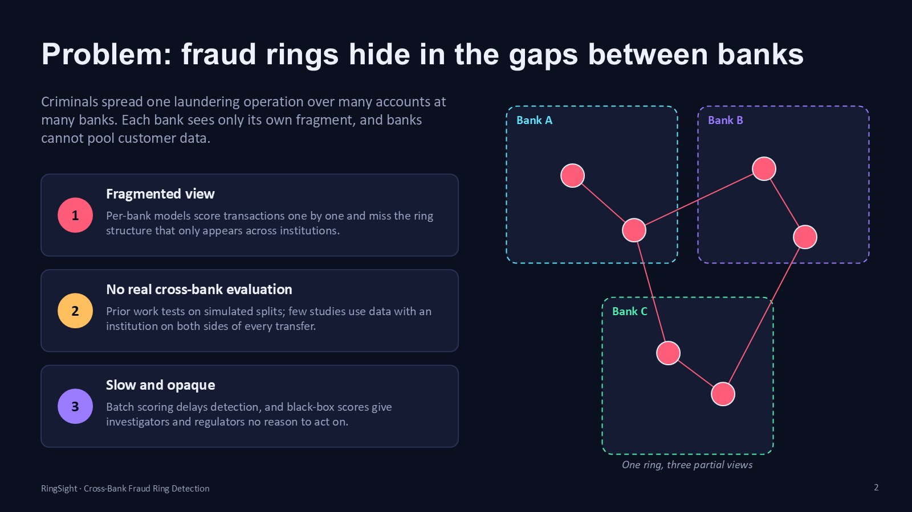

Criminals spread one laundering operation over many accounts at many banks. Each bank sees only its own fragment, and banks cannot pool customer data. Current systems fall short in three ways:

1. **Fragmented view.** Per-bank models score transactions one by one and miss the ring structure that only appears across institutions.
2. **No genuine cross-bank evaluation.** Prior work tests on simulated splits; few studies use data with an institution on both sides of every transfer.
3. **Slow and opaque.** Batch scoring delays detection, and black-box scores give investigators and regulators no reason to act on.

## 2. Objectives

| Objective | How |
|---|---|
| Detect rings across banks | A federated heterogeneous GNN that learns from every bank without pooling raw data |
| Detect them early | Score new transactions as they arrive, using incremental graph updates |
| Explain every flag | Attention, feature attribution and plain-language reasons an investigator can act on |
| Evaluate honestly | A real public multi-institution benchmark, with temporal and ring-disjoint splits |

## 3. Proposed methodology

### 3.1 Pipeline

| Step | What happens |
|---|---|
| 1 Clean | Remove duplicates, convert to USD, split accounts into consortium members and external institutions, split by time |
| 2 Bank graph | Each bank builds a graph of its own accounts plus *ghost* nodes for counterparties at other banks, with 6 relation types |
| 3 Features | 28 behaviour features per account and 14 per transfer |
| 4 Nested GNN | The inner GNN reads each account's 2-hop subgraph; the outer GNN reads the account network |
| 5 Federate | FedAvg, secure aggregation and a cross-bank embedding exchange |
| 6 Score & explain | Transfer risk, account risk, rings and reasons |

**Data.** The IBM AMLworld HI-Small benchmark (Altman et al., NeurIPS 2023): 5.08M transfers, each with the institution on both sides, plus laundering attempts labelled in 8 typologies.
- **Consortium:** the 8 largest institutions are the federated clients (15,262 accounts). Their 41,934 counterparties at other institutions become ghost nodes.
- **Split:** transfers before day 8 are used for training; the 87,602 later transfers are replayed live. Laundering rings that share accounts are kept in the same split.

### 3.2 Nested GNN: a graph inside the graph

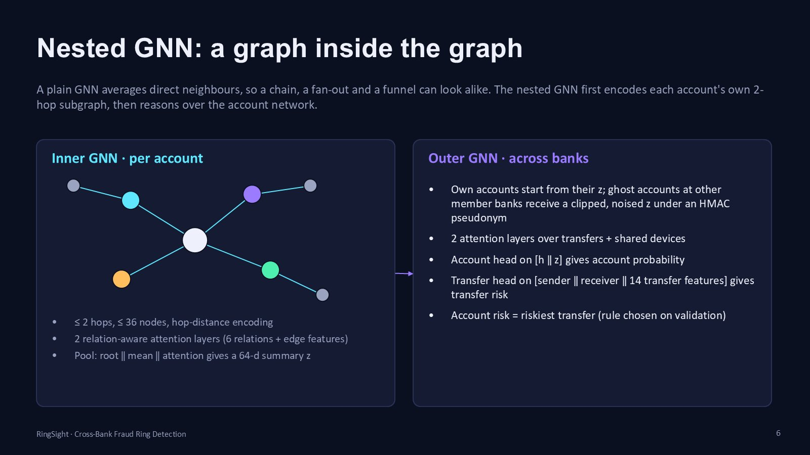

A plain GNN averages an account's direct neighbours, so a chain, a fan-out and a funnel can look the same. The nested GNN first encodes each account's own 2-hop subgraph, then reasons over the account network.

- **Inner GNN (per account).**
  - The subgraph is at most 2 hops and 36 nodes, and each node carries its hop distance from the account.
  - Two relation-aware attention layers run over it, using 6 relation types and the edge features.
  - Pooling (root ‖ mean ‖ attention) produces a 64-number summary **z**: a fingerprint of the account's neighbourhood shape.
- **Outer GNN (across banks).**
  - Own accounts start from their z. Ghost accounts held at other member banks receive a clipped, noised z under an HMAC pseudonym.
  - Two attention layers run over transfers and shared devices.
- **Output heads.**
  - The account head on [h ‖ z] gives the account probability.
  - The transfer head on [sender ‖ receiver ‖ 14 transfer features] gives each transfer's risk.
  - Account risk is its riskiest transfer. This combination rule was chosen on validation data.

### 3.3 Federated training and privacy

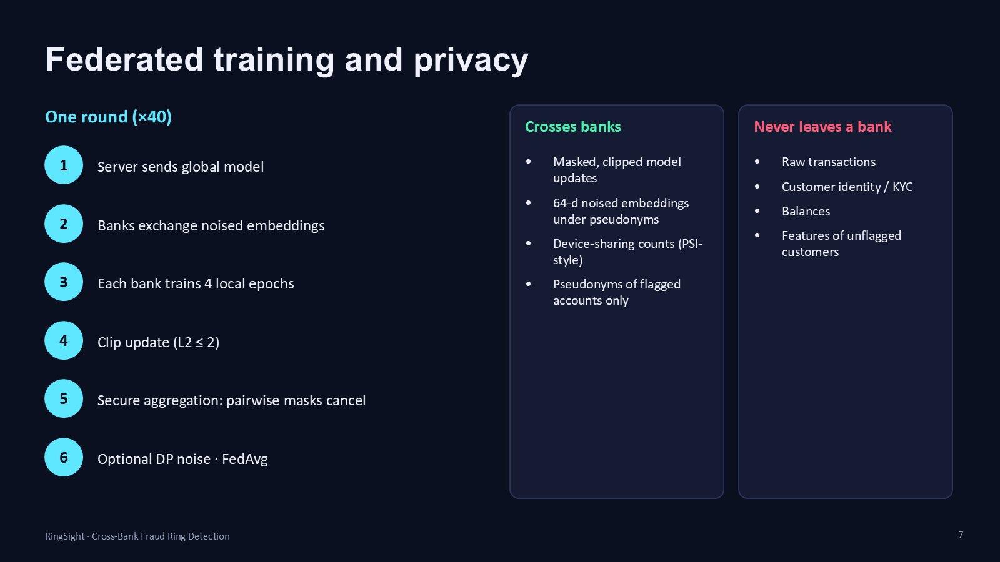

Each round (40 in total) runs these steps:
1. The server sends the global model to every bank.
2. Banks exchange noised embeddings.
3. Each bank trains for 4 local epochs.
4. Each bank clips its update (L2 ≤ 2).
5. Secure aggregation runs: pairwise masks cancel, so the server sees only the sum.
6. Optional DP noise is added, then the updates are averaged (FedAvg).

| Crosses banks | Never leaves a bank |
|---|---|
| Masked, clipped model updates | Raw transactions |
| 64-d noised embeddings under pseudonyms | Customer identity / KYC |
| Device-sharing counts (PSI-style) | Balances |
| Pseudonyms of flagged accounts only | Features of unflagged customers |

## 4. Novelty

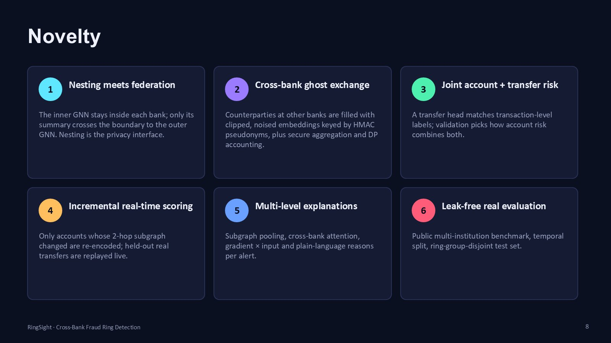

1. **Nesting meets federation.** The inner GNN stays inside each bank; only its summary crosses the boundary to the outer GNN, so the nesting is also the privacy interface.
2. **Cross-bank ghost exchange.** Counterparties at other banks are filled with clipped, noised embeddings keyed by HMAC pseudonyms, alongside secure aggregation and DP accounting.
3. **Joint account and transfer risk.** A transfer head matches the transaction-level labels, and validation data decides how account risk combines the two.
4. **Incremental real-time scoring.** Only accounts whose 2-hop subgraph changed are re-encoded, and held-out real transfers are replayed live.
5. **Multi-level explanations.** Each alert comes with subgraph pooling weights, cross-bank attention, gradient × input attribution and plain-language reasons.
6. **Leak-free real evaluation.** A public multi-institution benchmark, a temporal split and a test set split by groups of rings.

## 5. System architecture

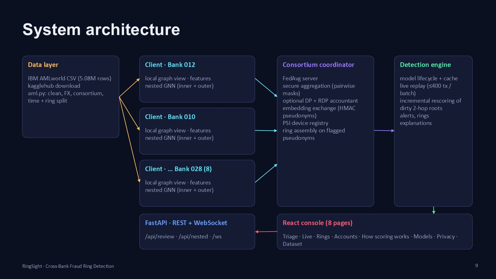

| Layer | Component | Code |
|---|---|---|
| Data | IBM AMLworld download, cleaning, consortium construction, temporal and ring split | [backend/app/aml.py](backend/app/aml.py) |
| Bank clients | Local graph views, features, nested GNN | [graph.py](backend/app/graph.py), [features.py](backend/app/features.py), [model.py](backend/app/model.py) |
| Consortium coordinator | FedAvg, secure aggregation, DP accountant, embedding exchange, PSI registry, ring assembly | [train.py](backend/app/train.py), [privacy.py](backend/app/privacy.py), [rings.py](backend/app/rings.py) |
| Detection engine | Model lifecycle, live replay (≤ 400 transfers per batch), incremental rescoring, alerts, explanations | [engine.py](backend/app/engine.py), [explain.py](backend/app/explain.py) |
| API | FastAPI, REST + WebSocket (`/api/review`, `/api/nested`, `/ws`, …) | [main.py](backend/app/main.py) |
| UI | React console with 8 pages (Recharts, three.js) | [frontend/](frontend/) |

## 6. Investigator console

| | |
|---|---|
| 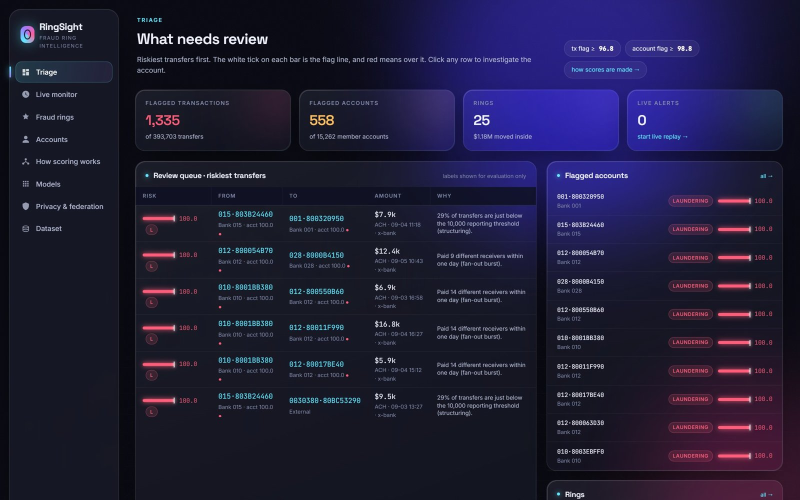 | **Triage: what needs review.** The review queue ranks the riskiest transfers, with both parties' account risk, payment rail, amount and the first red-flag reason. A white tick on each risk bar marks the flag line, and the bar turns red above it. The queue shows 1,335 flagged transfers, 558 flagged accounts and 25 rings. |
| 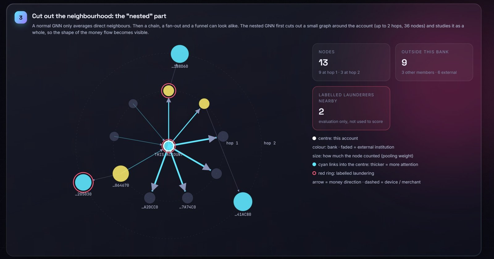 | **How scoring works.** One real account is walked through six steps: ledger, features, subgraph, inner GNN, outer GNN, decision. The account's real 2-hop subgraph is drawn: size = pooling weight, cyan width = attention, red ring = labelled launderer. |
| 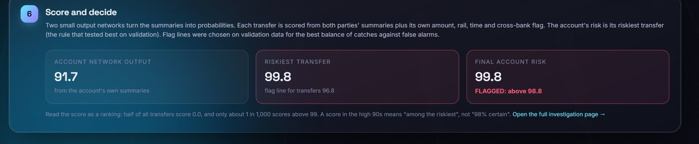 | **Decision.** For account 012·8001555A0, the account output is 91.7 and the riskiest transfer scores 99.8, so the final risk is 99.8. That is above the 98.8 flag line, so the account is flagged. |
| 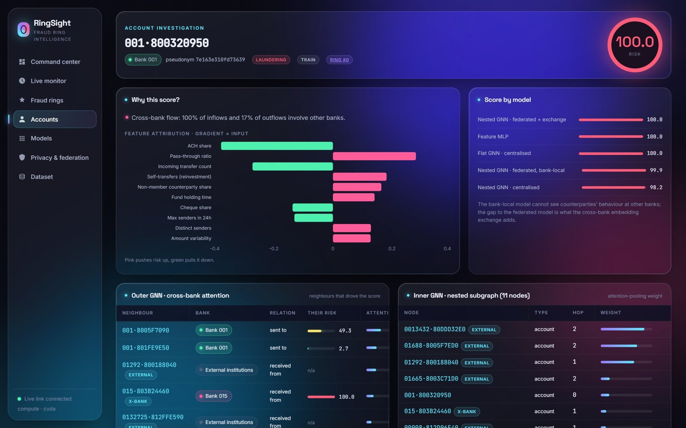 | **Account investigation.** Plain-language reasons (shown only when a value is genuinely unusual), gradient × input attribution, the same account scored by all five models, and attention over its partners at other banks. |
| 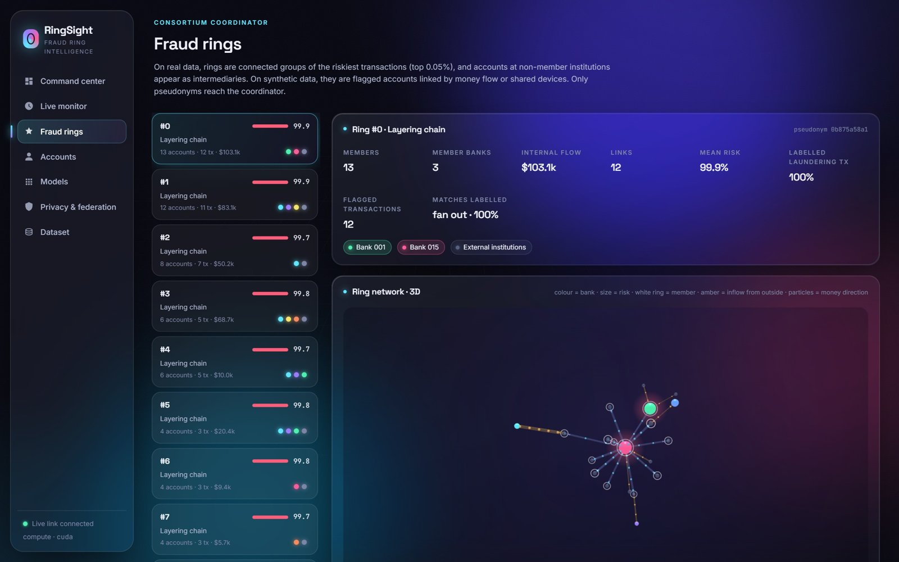 | **Fraud rings.** Rings are connected groups of the riskiest 0.05% of transfers, with external institutions shown as intermediaries. The 3D network colours nodes by bank and shows money direction. Ring #0 has 13 accounts and 12 transfers, all labelled laundering. |
| 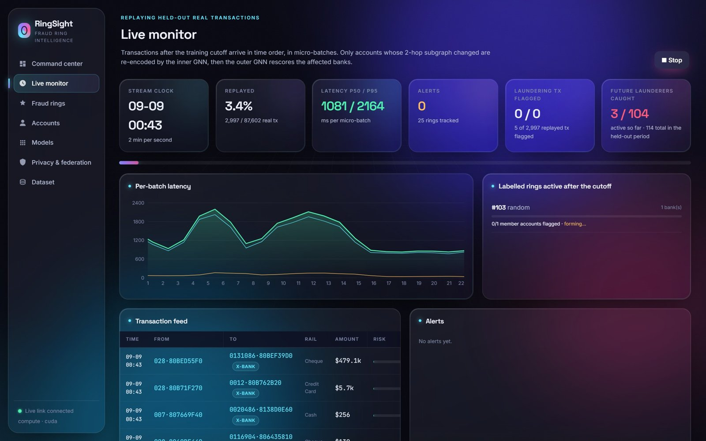 | **Live monitor.** Replays the 87,602 held-out real transfers in time order and re-encodes only the subgraphs that changed. Each micro-batch of about 160 transfers takes about 1–2 s on an RTX 3050. |

The console also has Accounts, Models, Privacy & federation and Dataset pages.

## 7. Results

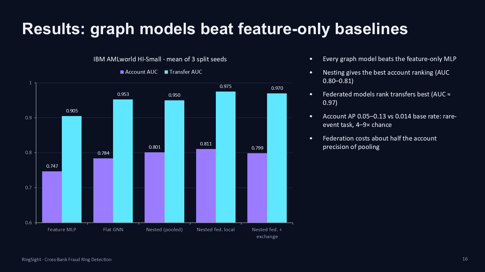

IBM AMLworld HI-Small, mean of 3 split seeds:

| Model | Account AUC | Account AP | Transfer AUC | Transfer AP |
|---|---|---|---|---|
| Feature MLP | 0.747 | 0.067 | 0.905 | 0.080 |
| Flat heterogeneous GNN | 0.784 | 0.128 | 0.953 | 0.134 |
| Nested GNN (pooled) | 0.801 | 0.105 | 0.950 | 0.077 |
| Nested GNN, federated, bank-local | **0.811** | 0.062 | **0.975** | 0.049 |
| Nested GNN, federated + exchange | 0.799 | 0.054 | 0.970 | 0.041 |

- Every graph model beats the feature-only MLP.
- Nesting gives the best account ranking (AUC 0.80–0.81).
- The federated models rank transfers best (AUC ≈ 0.97).
- Laundering is rare: 1.4% of accounts and 0.05% of transfers. Account AP of 0.05–0.13 against a 0.014 base rate is 4–9× better than chance.

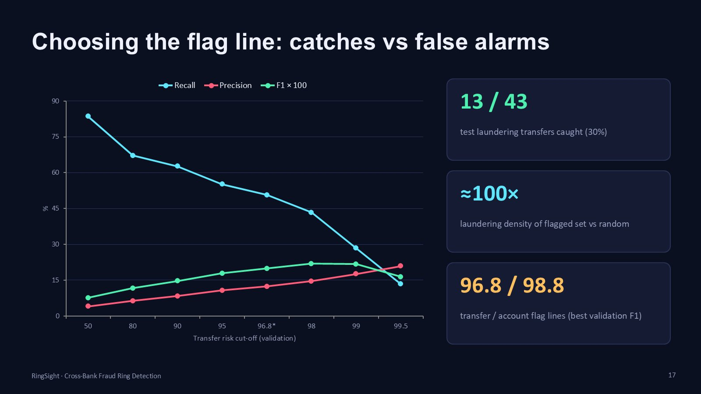

**Choosing the flag line.** The flag lines are the cut-offs with the best validation F1: **96.8** for transfers and **98.8** for accounts. On the test set, **13 of 43** laundering transfers are caught, and the flagged set holds about **100×** more laundering than a random sample of the same size.

**What worked**
- The transaction-level head lifted account AUC from about 0.70 to about 0.80 on real data.
- Rings built from the riskiest transfers are mostly real laundering: the top rings are 90–100% labelled laundering.
- The cross-bank exchange helped on synthetic data (AP 0.927 vs 0.914 for bank-local).
- An evaluation leak was found and fixed: splitting ring by ring had inflated AP to about 0.15.

**Limits**
- Live latency is about 1–2 s per batch, dominated by rebuilding the 8 bank views.
- The differential-privacy budget (ε) is large at the default noise level.
- The benchmark data is realistic but synthetic; no public real inter-bank dataset exists.
- Federation and secure aggregation are simulated in a single process.

## 8. Conclusion and future work

**Conclusion**
- The project delivers a working end-to-end system: a nested federated heterogeneous GNN, a privacy-preserving exchange, live scoring and an explainable investigator console.
- On a public multi-institution benchmark, graph structure adds real signal over per-account features.
- Federation keeps data inside each bank, at a measurable cost in precision.
- Every flag comes with reasons an analyst can act on.

**Future work**
1. Incremental graph updates, for sub-300 ms latency.
2. Transaction-level message exchange, more member banks and lower noise.
3. Real multi-process federation with key agreement.
4. Calibrated scores (Platt / isotonic).
5. Case management, audit trail, SAR export and role-based access.
6. The HI-Medium / HI-Large and low-illicit variants, plus drift monitoring.

## 9. Run it

```powershell
pip install -r backend/requirements.txt
./start.ps1                      # builds the UI if needed, serves http://127.0.0.1:8000
```

- **First start:** downloads the IBM dataset through `kagglehub` (public, about 450 MB, no login), cleans it, and trains 5 models. This takes about 15 minutes on a GPU.
- **Later starts:** load the cached data and models in seconds.
- **Error 10048:** port 8000 is already in use. Stop the other server, or start this one with `--port 8001`.

| Setting | Effect |
|---|---|
| `FRAUD_DATASET=synthetic` | Use the quick synthetic demo data |
| `FRAUD_RETRAIN=1` | Retrain all models |
| `FRAUD_DEVICE=cpu` | Run on the CPU |

Tests:

```powershell
cd backend; python -m pytest -q        # 26 unit, API and real-data tests
python e2e/test_ui.py                   # browser test of every page (server running)
python backend/benchmark.py 3 ibm_aml   # multi-seed model comparison
```


## 10. Repository layout

```
backend/app/      aml.py · data.py · features.py · graph.py · model.py · train.py
                  privacy.py · rings.py · explain.py · engine.py · main.py
backend/tests/    unit, API and real-data tests
backend/benchmark.py
frontend/         React console (src/pages: Overview, NestedGnn, Live, Rings, Accounts, Account, Models, Privacy, Dataset)
e2e/              Playwright browser test
docs/images/      figures used in this README
start.ps1         build the UI if needed and start the server
```

## References

- E. Altman et al., *Realistic Synthetic Financial Transactions for Anti-Money Laundering Models*, NeurIPS 2023 Datasets & Benchmarks.
- M. Zhang, P. Li, *Nested Graph Neural Networks*, NeurIPS 2021.
- B. McMahan et al., *Communication-Efficient Learning of Deep Networks from Decentralized Data*, AISTATS 2017.
- K. Bonawitz et al., *Practical Secure Aggregation for Privacy-Preserving Machine Learning*, CCS 2017.
- I. Mironov, *Rényi Differential Privacy*, CSF 2017.
- V. Blondel et al., *Fast unfolding of communities in large networks*, J. Stat. Mech. 2008.
